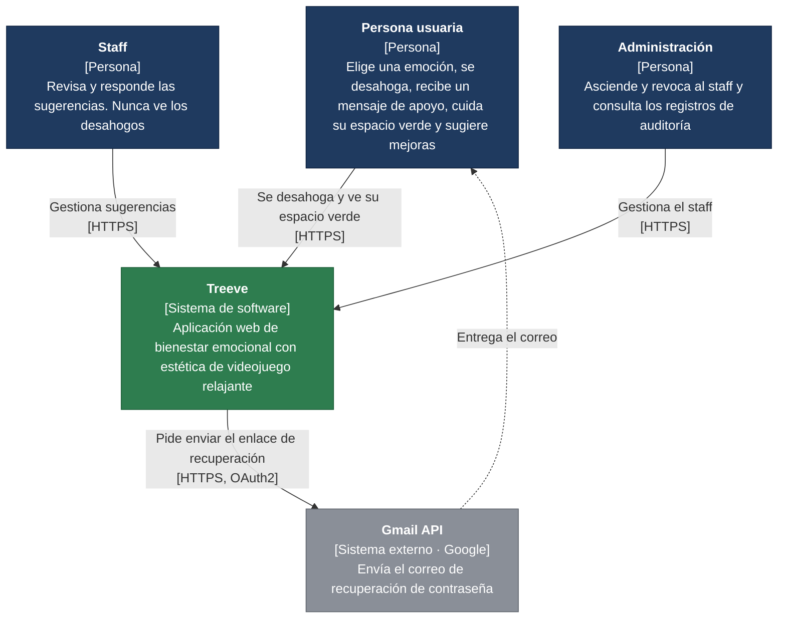
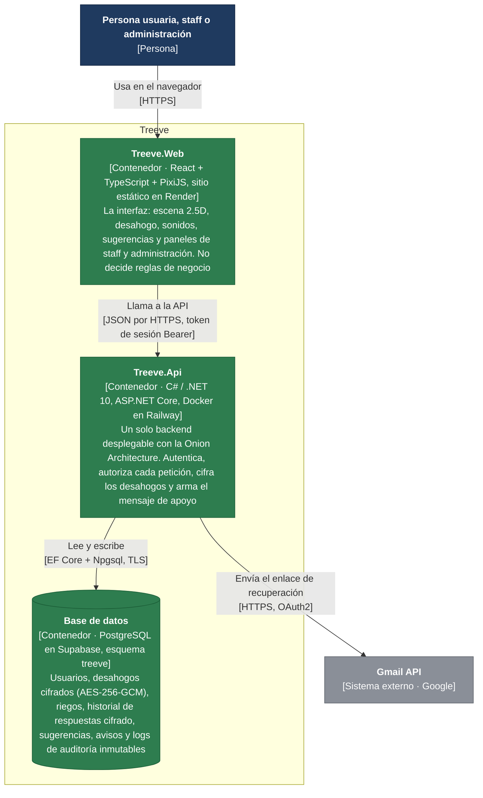
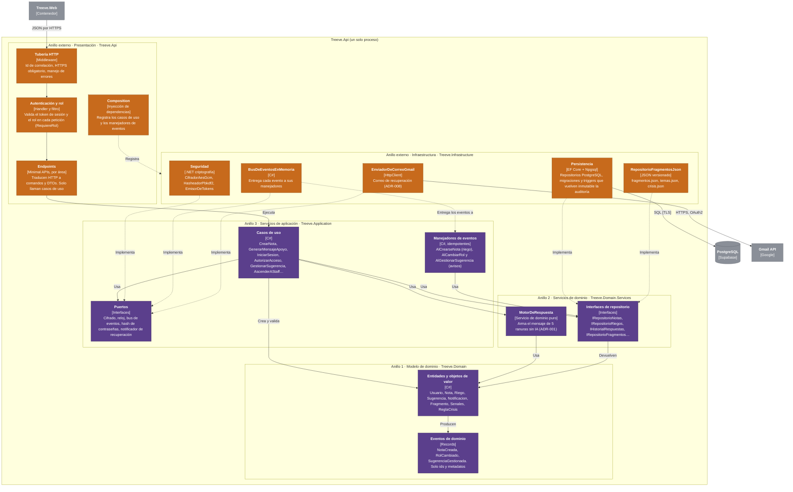
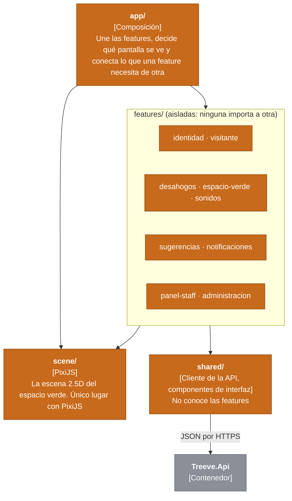
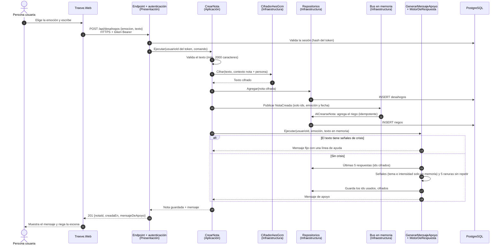

# Treeve · Modelo C4

Diagramas de la arquitectura de Treeve tal como está construida (TEC-05, 3 de noviembre de 2026). Las decisiones de fondo están en los [ADRs](../adr/README.md); la estructura del código, en la [guía del backend](../guias/backend.md) y la [del frontend](../guias/frontend.md).

## Cómo leerlo

C4 describe un sistema con **cuatro niveles de zoom**, como un mapa: primero el país, luego la ciudad, luego el barrio. Cada nivel responde una pregunta distinta.

| Nivel | Pregunta | Para quién |
|---|---|---|
| 1 · Contexto | ¿Quién usa Treeve y con qué sistemas externos habla? | Cualquiera, también sin saber programar |
| 2 · Contenedores | ¿Qué piezas se despliegan por separado y cómo se comunican? | El equipo y quien opera el despliegue |
| 3 · Componentes | ¿Cómo está organizada por dentro cada pieza? | Quien programa |
| Vista dinámica | ¿Qué pasa, paso a paso, en un caso de uso concreto? | Quien programa o revisa |

El nivel 4 (clases) no se dibuja: lo cuenta el código.

**Las cajas.** Cada una dice su nombre, entre corchetes **qué es** (persona, sistema, contenedor o componente) y **con qué tecnología** está hecha, y debajo una frase de **qué hace**.

**Los colores.**

| Color | Significa |
|---|---|
| Azul oscuro | Personas |
| Verde | Lo que construimos (Treeve y sus piezas) |
| Gris | Sistemas externos que usamos pero no construimos |
| Morado, en el nivel 3 | Los anillos del núcleo del Onion (modelo de dominio, servicios de dominio y aplicación) |
| Naranja, en el nivel 3 | Los anillos externos (presentación e infraestructura) |

**Las flechas.** Van **de quien usa a quien es usado**, y su etiqueta dice qué viaja y cómo. Una flecha continua es una llamada o una dependencia; una **punteada** es "implementa" (la infraestructura implementa una interfaz del núcleo) o un evento.

**La regla que se debe ver en el nivel 3.** En el Onion todas las dependencias apuntan **hacia adentro**: presentación → aplicación → servicios de dominio → modelo de dominio. Si alguna flecha continua saliera del núcleo hacia un anillo externo, rompería la regla de dependencias (ADR-004); la CI no lo permite.

**Los recuadros grandes** marcan límites: qué queda dentro de Treeve (nivel 2) o dentro de la API (nivel 3).

---

## Nivel 1 · Contexto del sistema

Staff y administración son la misma aplicación con otro rol: entran por `/staff` con su cuenta, y la API valida el rol en cada petición (HU-10, ADR-006).

---

## Nivel 2 · Contenedores

- **Solo la API toca la base de datos** (ADR-002): el frontend no tiene cliente de base de datos, y `dependency-cruiser` lo verifica. La llave de cifrado vive en una variable de entorno de Railway, nunca en la base.
- **Railway termina el TLS** y reenvía a la API; la API rechaza cualquier `/api` que no haya llegado por HTTPS y manda HSTS.
- **Las migraciones** se aplican solas cuando arranca la API, siempre con migraciones versionadas de EF Core.

---

## Nivel 3 · Componentes de Treeve.Api

Cada recuadro es un anillo del Onion (ADR-004) y un proyecto de .NET. Las áreas funcionales (Identidad, Desahogos, EspacioVerde, MensajesApoyo, Sugerencias, Administracion, Notificaciones) son **carpetas** dentro de cada anillo, no proyectos.

**Qué mirar:**

- Todas las flechas continuas dentro de la API van de un anillo externo a uno interno, o se quedan dentro del núcleo. El núcleo (morado) no conoce ASP.NET Core, EF Core ni HTTP: lo verifican `tests/Treeve.ArchitectureTests` con ArchUnitNET.
- La infraestructura nunca es llamada directamente por los casos de uso: los casos de uso usan **interfaces** del núcleo, y la infraestructura las **implementa** (flechas punteadas). Por eso una IA futura para los mensajes entraría como otra implementación de `IGeneradorMensajeApoyo`, sin tocar el dominio (ADR-001).
- La **presentación** solo usa la infraestructura para registrarla en el contenedor de dependencias (`Composition`).

### Componentes de Treeve.Web

El frontend es presentación, en el anillo externo. Su organización interna la verifica `dependency-cruiser`.

---

## Vista dinámica · Guardar un desahogo

El caso más importante: privacidad (HU-05) y rendimiento (≤ 2 s, HU-06) en la misma petición. Se lee de arriba abajo; cada flecha es una llamada y su respuesta vuelve por la flecha punteada.

**Qué mirar:**

- El texto viaja en claro solo **dentro de la petición**: se cifra antes de guardarse, el evento no lo lleva, el tema detectado nunca se guarda y nada lo escribe en el log. `tests/Treeve.Api.Tests` lo comprueba recorriendo toda la base y todo el log (ADR-009).
- El mensaje de apoyo se arma **en la misma petición**, no por evento, para cumplir los 2 s (ADR-001). El riego sí va por evento, porque es otra área (EspacioVerde) y no debe acoplarse a Desahogos.
- La persona sale **del token**, nunca del cuerpo de la petición: nadie puede guardar un desahogo a nombre de otra.
